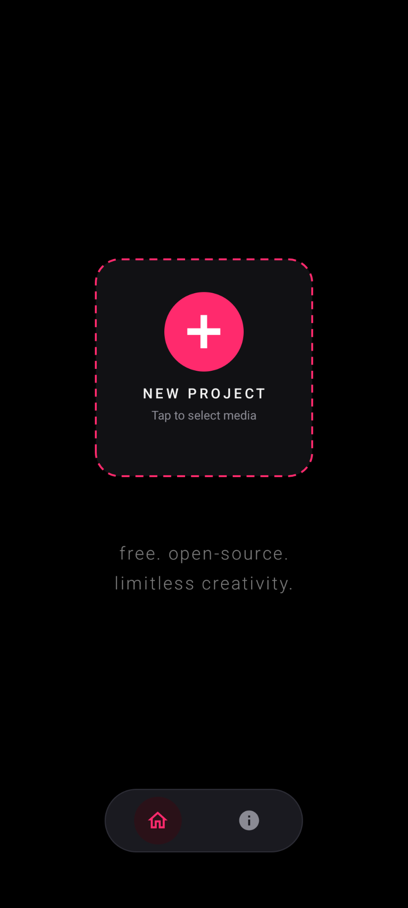
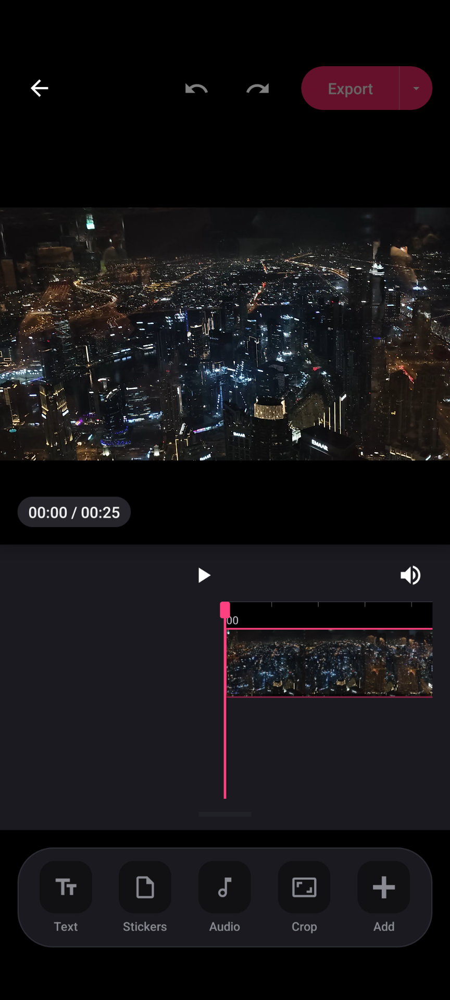
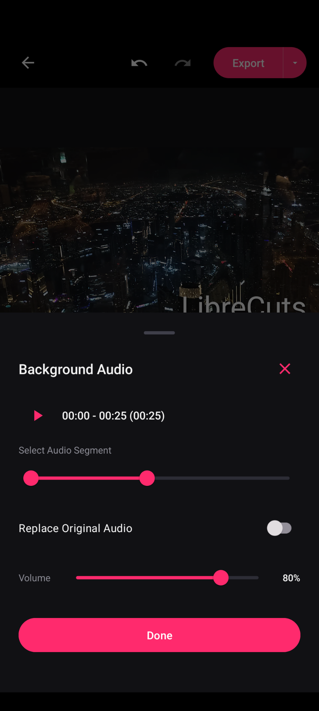
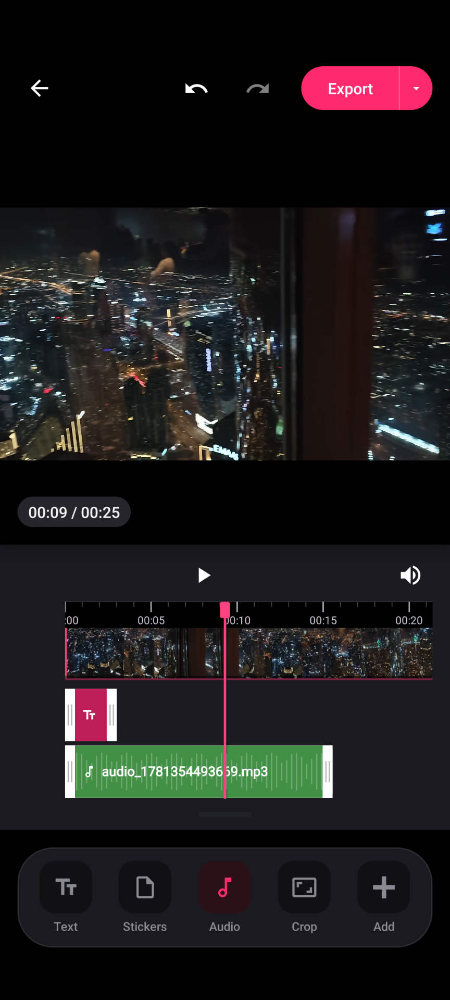

# Vydra

**Vydra** is a powerful video editing application for Android creators that prioritizes speed, precision, and privacy. Built for mobile workflow and content creation, it empowers users to trim, arrange, overlay, caption, and export watermark-free videos locally on their device.

> **Attribution & Heritage:** Vydra is developed from the open-source project created by Tharun Birla and community contributors under the MIT License.

---

## ✊ Keep Android Open

Google's mandatory developer verification policy goes into effect in **September 2026** (in just a few months). This mandate requires all independent developers to submit government ID and centrally register with Google, threatening user privacy, sideloading freedom, and the distribution of free and open-source software (FOSS) on Android. 

Help resist this gatekeeping and support the movement at [keepandroidopen.org](https://keepandroidopen.org/).

---

## 🚀 Features

- **Trim** - Remove unwanted parts from the beginning or end of a video clip with a real-time timeline control.
- **Overlays** - Place text, stickers, images, GIFs, and video overlays on top of video clips to create engaging content. Includes support for continuous media looping.
- **Masking** - Apply various mask shapes to your overlays for creative effects.
- **Chroma Key** - Remove backgrounds from any overlay using the green screen effect.
- **Keyframes** - Animate overlays across the screen with keyframe support.
- **Subtitles (Captions)** - Import custom `.srt` subtitle files with a dedicated toolbar slider for resizing and fully interactive touch-based positioning directly on the video preview.
- **Layer Management** - Easily reorder overlay layers to control what renders on top.
- **Audio** - Manage soundtracks effortlessly by importing custom music or audio tracks, recording voice overs, applying audio ducking and fades, amplifying volume up to 200%, and muting original audio.
- **Audio Export** - Export your project's entire audio mix as a standalone MP3 file.
- **Snapshots** - Capture and save high-quality frame grabs (snapshots) directly from the video editor.
- **Crop** - Adjust the aspect ratio of a video with custom cropping support.
- **Merge** - Combine multiple video segments into a continuous sequence with drag-to-rearrange functionality.
- **Transition** - Apply transitions with animated visual previews in the toolbar.
- **Speed** - Change the speed of a video clip using a custom speed slider for granular control.
- **Adjust & Filters** - Modify video brightness, contrast, saturation, and apply color filters.
- **Canvas Background** - Add a blurred background or a solid color for a cohesive look when your video aspect ratio does not match the project frame.
- **Reverse** - Reverse video playback.
- **Timeline Organization** - Enhanced editing with snapping functionality, overlay duplication, freeze frame actions, and improved UI visual styling.
- **Project Save & Import** - Save non-destructive project state as a `.lcprj` file to save and reopen editable project files anytime.
- **Freehand Drawing** - Draw directly on top of video clips with custom brush color and stroke controls.
- **Custom Fonts** - Import `.ttf` or `.otf` font files to customize text overlay typography.
- **Fullscreen Preview** - Switch to true fullscreen preview mode with expanded timeline view and overlay controls.
- **Android 13+ Themed Icon** - Supports native monochrome adaptive icons for Android 13+ system themes.
- **Hardware Acceleration** - Super-fast and reliable video exports using device hardware-accelerated `h264_mediacodec` encoding (with seamless automatic fallback to software encoding for maximum device compatibility) and accurate FFmpeg progress calculation.

## 📱 Screenshots

  <table>
    <tr>
      <td align="center"></td>
      <td align="center"></td>
      <td align="center"></td>
      <td align="center"></td>
    </tr>
    <tr>
      <td align="center"><b>Home Screen</b></td>
      <td align="center"><b>Editor Screen</b></td>
      <td align="center"><b>Audio Import</b></td>
      <td align="center"><b>Timeline</b></td>
    </tr>
  </table>

## 💬 Community & Support

Join our community for updates, discussions, and support.

## 🛠️ Getting Started

### Prerequisites

- Android Studio
- Android SDK

### Installation

1. **Build the project**:
   - Open in Android Studio or compile with Gradle.
2. **Run the app**:
   - Connect an Android device or start an emulator.

## 🔒 Permissions

Vydra requires the following permissions to function properly:

- **READ_EXTERNAL_STORAGE**: To read videos from the device.
- **WRITE_EXTERNAL_STORAGE**: (For older Android versions) To save edited videos.
- **POST_NOTIFICATIONS**: To show notifications related to video editing.
- **READ_MEDIA_AUDIO/VIDEO/IMAGES**: For accessing media files on devices running Android 13 (API level 33) and above.

## 🤝 Contributing

Contributions are welcome! If you have suggestions or improvements, feel free to create a pull request or open an issue.

1. Fork the repository.
2. Create a new branch for your feature or bug fix.
3. Commit your changes.
4. Push to the branch.
5. Submit a pull request.

## 📝 License

This project is licensed under the MIT License. See the [LICENSE](LICENSE) file for details.
